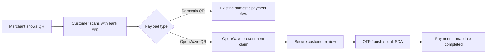

# OpenWave QR Design Guidelines

OpenWave QR design has two goals:

1. Make OpenWave-presented payments recognizable to customers.
2. Preserve interoperability by requiring scanners to route from the payload, not from visual branding.

## The rule

**The QR payload is the standard. The visual mark is only a trust cue.**

A compliant OpenWave QR may be displayed by a gateway, bank, wallet, merchant POS, invoice, ecommerce checkout, or app screen. All of them should use the same payload rules and broadly similar visual treatment.

## Customer-facing pattern

## OpenWave QR frame

Recommended display composition:

| Area | Content |
|---|---|
| Header | Merchant or acceptor name |
| Main | QR code with OpenWave center mark |
| Amount | Fixed amount and currency when known |
| Footer | Expiry, reference, or “Scan with your bank app” |
| Help text | Optional localized text for supported wallets/banks |

The QR must remain scannable without relying on color or visual decoration.

## Center mark

The center mark should be a compact OpenWave symbol, not a long wordmark.

Requirements:

- maximum 15% of QR symbol area
- high contrast against a white or light inner patch
- no customer, bank, merchant, OTP, or approval data
- no animation inside the QR itself
- QR error correction should be `H`

Allowed center marks:

| Mark | Use |
|---|---|
| `OPENWAVE_MARK` | Default for OpenWave-presented QR |
| `OPERATOR_MARK` | Allowed only when the OpenWave mark is also visible in the frame |
| `MERCHANT_MARK` | Allowed around the QR frame, not preferred inside the QR |
| `NONE` | Allowed for receipts, low-quality printers, or accessibility scenarios |

## Color and print

- Default QR modules should be dark on a light background.
- Avoid low-contrast brand colors inside the QR modules.
- Use the OpenWave accent color only in the center mark or surrounding frame.
- For receipts and black-and-white POS screens, use monochrome.
- Always keep a 4-module quiet zone.

## Captions

Recommended captions:

| Language | Caption |
|---|---|
| English | Pay with OpenWave |
| Arabic | ادفع عبر OpenWave |
| French | Payer avec OpenWave |

For smart scanner UI inside customer apps:

| Context | Recommended copy |
|---|---|
| Floating button tooltip | Scan QR |
| QR row title | Smart QR scan |
| QR row description | Detects domestic and OpenWave QR automatically |

## Scanner behavior

Every compliant scanner should follow this order:

1. Check for OpenWave HTTPS universal/app link or `openwave://` URI.
2. If EMV TLV, validate structure and CRC when present.
3. Search Merchant Account Information templates `26` to `51` for GUI `LY.OPENWAVE`.
4. If OpenWave is detected, claim the presentment before showing any success state.
5. If not OpenWave, continue domestic QR routing.
6. If neither profile is recognized, show an unsupported QR message.

## Security

The visual QR frame must not imply authorization. A scan only starts the flow.

The trusted customer surface must still show:

- merchant name
- amount and currency
- fees and total when applicable
- selected or masked funding account
- one-time or recurring intent
- expiry
- recurrence details for mandates

Merchants must never collect OTP, PIN, push approval, bank login, or customer credentials.

