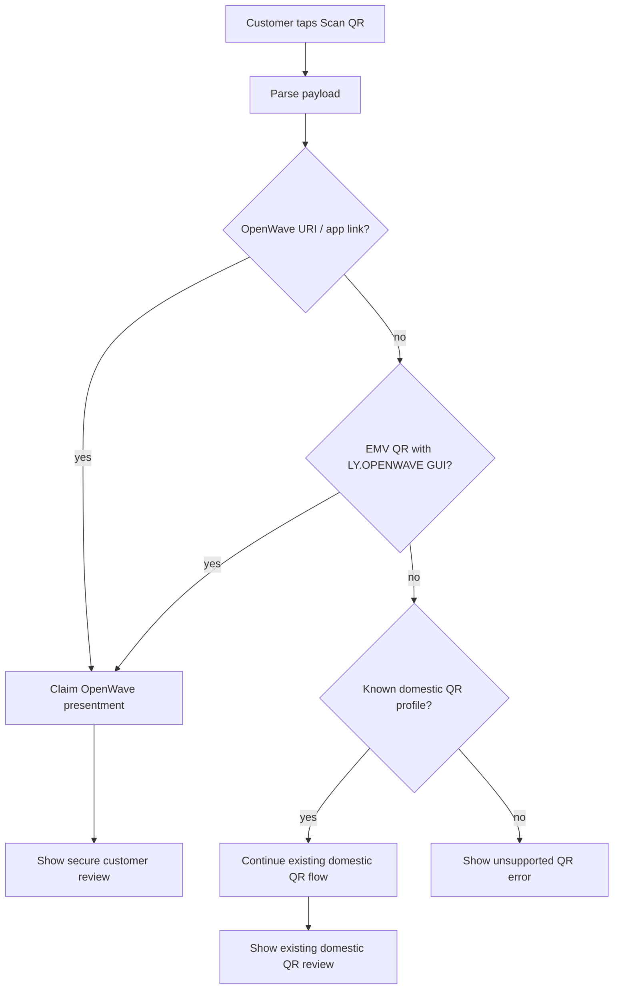
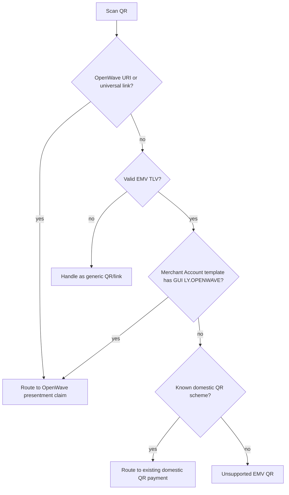

# QR Payloads

OpenWave QR payloads use an **EMVCo-compatible QR profile** with an OpenWave merchant-account template. The QR carries a signed/tokenized presentment reference, not bank secrets and not raw authorization data.

## QR design goal

The QR must be portable across operators and easy for banks or wallets to understand, while still forcing the real authorization to happen later in a secure surface.

## Smart scanner behavior

A bank, wallet, or payment app should expose **one payment QR scanner** when it already supports domestic QR rails. The scanner routes by payload, not by which button launched the camera.



This keeps the customer experience simple: one scan entry point can recognize:

- domestic static QR
- domestic dynamic QR
- internal bank transfer QR
- LyPay / NUMO QR where supported
- OpenWave merchant-presented payment QR
- OpenWave merchant-presented mandate approval QR

Scanners must not route based on the visual logo in the middle of the QR. The logo is a customer-recognition cue only. Routing must use the URI or EMV payload identifiers.

## Payload rules

- Must identify the presentment
- Must identify the operator or issuer
- Must carry expiry
- Must be replay-protected
- Must indicate whether the amount is fixed or open
- Must indicate whether the flow is `ONE_TIME_PAYMENT` or `MANDATE_APPROVAL`
- Must resolve to a customer review summary before approval

## EMV QR profile

OpenWave QR is a channel profile inside the normal EMV QR TLV structure. This lets an existing bank scanner parse one QR payload and decide whether to continue through the current domestic QR flow or through OpenWave.

Recommended merchant account information template:

| EMV tag | Meaning |
|---|---|
| `00` | Payload format indicator, normally `01` |
| `01` | Point of initiation method, `11` dynamic/open amount or `12` fixed amount |
| `26` | Recommended OpenWave Merchant Account Information template |
| `50` | Optional OpenWave operator template |
| `52` | Merchant category code |
| `53` | ISO 4217 numeric currency, for example `434` for LYD |
| `54` | Transaction amount when fixed |
| `58` | Country code |
| `59` | Merchant display name |
| `60` | Merchant city |
| `62` | Additional data such as merchant reference |
| `63` | CRC16/CCITT-FALSE checksum |

OpenWave template inside tag `26`:

| Sub-tag | Value |
|---|---|
| `00` | `LY.OPENWAVE` |
| `01` | `presentment_id` |
| `02` | short-lived claim token or signed reference |
| `03` | compact channel code, normally `QR` |
| `04` | compact intent code, `P` for one-time payment or `M` for mandate approval |

Operator or gateway id should be carried in the optional OpenWave operator template tag `50`, or resolved from the presentment directory. Do not use NUMO `62-*` sub-tags for OpenWave routing metadata because NUMO already defines those for bill/reference/terminal-purpose data.

OpenWave operator template inside tag `50`:

| Sub-tag | Value |
|---|---|
| `00` | `LY.OPENWAVE.OP` |
| `01` | operator or gateway id |

If a deployment already uses tag `26`, it may use another unused EMV Merchant Account Information tag from `26` to `51`. The scanner must look for the `LY.OPENWAVE` GUI inside those templates before routing to OpenWave.

## Scanner routing



## Visual and UI guidelines

OpenWave QR needs a consistent visual treatment so customers can recognize it across gateways, banks, wallets, POS terminals, invoices, and merchant checkout pages. Visual branding must never become the security control.

### Required visual rules

| Rule | Requirement |
|---|---|
| Quiet zone | Keep at least 4 QR modules of clear quiet zone around the code. |
| Error correction | Use level `H` when a center mark is placed inside the QR. Use at least `Q` for high-density printed or low-quality displays. |
| Center mark | Prefer the simple OpenWave mark in the center for OpenWave-presented QR. Keep it compact and high contrast. |
| Center mark size | Do not cover more than 15% of the QR symbol area unless the QR generator validates scannability on common devices. |
| Payload routing | Scanner routing must use `openwave://`, HTTPS app/universal link, or EMV GUI `LY.OPENWAVE`, not the center logo. |
| Caption | Use a short caption such as `Pay with OpenWave` or localized equivalent. |
| Review screen | After scan, show merchant, amount, currency, expiry, account, fees, and recurring terms where applicable before approval. |

### Recommended QR frame

Use a clean payment frame:

- OpenWave mark centered in the QR.
- Merchant or operator name below the QR.
- Amount near the QR for fixed-amount flows.
- Expiry or “valid until” when the presentment is short-lived.
- “Scan with your bank or OpenWave-compatible wallet” when the merchant surface is public.

Do not place OTPs, bank credentials, approval words, or customer secrets beside the QR.

### Center mark shape

The OpenWave mark should be simple enough to stay legible at small POS and receipt sizes:

- one compact wave or connected-payment symbol
- one color or monochrome depending on background
- no long wordmark inside the QR
- no thin detail that disappears below 24 px

Operator or merchant marks may be shown around the QR frame, but the center mark should remain OpenWave when the payload is an OpenWave presentment. This gives customers one network-level recognition cue, similar to national QR payment marks in other markets.

### App UI guideline

Customer apps should label the camera entry point as a smart QR payment scanner, not as a separate OpenWave-only scanner, when domestic QR and OpenWave QR share the same camera flow.

Recommended labels:

| Context | Label |
|---|---|
| Floating pay action | `Scan QR` |
| QR page row | `Smart QR scan` |
| Description | `Detects domestic and OpenWave QR automatically` |

If the app only supports OpenWave QR and no domestic QR scheme, `Scan OpenWave QR` is acceptable.

## Recommended payload fields

| Field | Why it exists |
|---|---|
| `presentment_id` or signed reference | Uniquely identifies the presentment |
| `operator_id` | Tells the scanner where the presentment belongs |
| `intent` | Distinguishes one-time payment from mandate approval |
| `mode` | Fixed to `MERCHANT_PRESENTED` in v1 |
| `amount_mode` | Tells the scanner whether amount is fixed or open |
| `expires_at` | Prevents stale QR reuse |
| `sig` | Protects integrity and replay safety |

## Example merchant-presented QR object

```json
{
  "format": "EMV_QR",
  "value": "00020101021226890011LY.OPENWAVE0136prs_01J15B6A1N2QZ5YP4V4P4FJW400222short-lived-claim-code0302QR0401P50310014LY.OPENWAVE.OP0114andalus-direct5204000053034345406860.0005802LY5909OpenWave6007Tripoli6304A1B2",
  "emv_profile": {
    "merchant_account_information_tag": "26",
    "gui": "LY.OPENWAVE"
  },
  "intent": "ONE_TIME_PAYMENT",
  "mode": "MERCHANT_PRESENTED",
  "amount_mode": "FIXED",
  "amount": 860000,
  "currency": "LYD",
  "expires_at": "2026-05-15T19:30:00Z"
}
```

## Example recurring mandate approval QR object

```json
{
  "format": "EMV_QR",
  "value": "00020101021226730011LY.OPENWAVE0120prs_01J15MANDATE94T70222short-lived-claim-code0302QR0401M50310014LY.OPENWAVE.OP0114andalus-direct520400005303434540610.0005802LY5909OpenWave6007Tripoli6304F00D",
  "intent": "MANDATE_APPROVAL",
  "mode": "MERCHANT_PRESENTED",
  "amount_mode": "FIXED",
  "amount": 10000,
  "currency": "LYD",
  "recurrence": {
    "frequency": "MONTHLY",
    "end_date": "2027-05-15"
  },
  "expires_at": "2026-05-15T19:30:00Z"
}
```

## Merchant-presented QR

Merchant-presented QR is appropriate for:

- online bill pages
- in-store screens
- printed invoices
- subscription signup flows that lead into hosted mandate approval

## App and platform wallet handoff

Some quick flows start from an app, universal link, Android app link, iOS app link, or platform wallet handoff instead of a camera QR scan. These flows should still use the same OpenWave presentment contract:

- the handoff carries a signed OpenWave URI or tokenized presentment reference
- the claim endpoint returns a secure authorization surface
- the customer review summary is shown before approval
- final payment or mandate status follows the normal OpenWave lifecycle

This allows banks, wallets, and gateways to support platform-specific user experiences without fragmenting the payment standard.

## Interoperability note

The QR payload format is EMV-compatible and OpenWave-routable. Gateways, banks, and wallets can all implement it directly as long as they honor capability discovery, the `LY.OPENWAVE` template, and security requirements. Existing domestic QR schemes should keep their identifiers and continue to route normally.

## Validation checklist for scanners

1. Parse URI/universal-link payloads first.
2. If the payload is EMV TLV, validate structure and CRC where available.
3. Search EMV Merchant Account Information tags `26` to `51` for GUI `LY.OPENWAVE`.
4. Check expiry and operator/issuer trust by resolving the presentment.
5. Refuse presentments that require unsupported modes or intents.
6. Claim the presentment over the network before showing success to the customer.
7. Show the customer review summary.
8. Open the claim-returned hosted URL, SDK sheet, wallet handoff, or bank-app handoff before any authorization or completion state.

## Security notes

- A QR code must never embed customer OTP, PIN, passcode, push approval result, bank credentials, or approval proof.
- Operators should sign or tokenize the payload so tampering is detectable.
- Printed or cached QR codes should expire quickly when tied to a fixed amount.
- QR is only a channel layer. After claim, authorization still happens through the normal OpenWave payment or mandate lifecycle.
